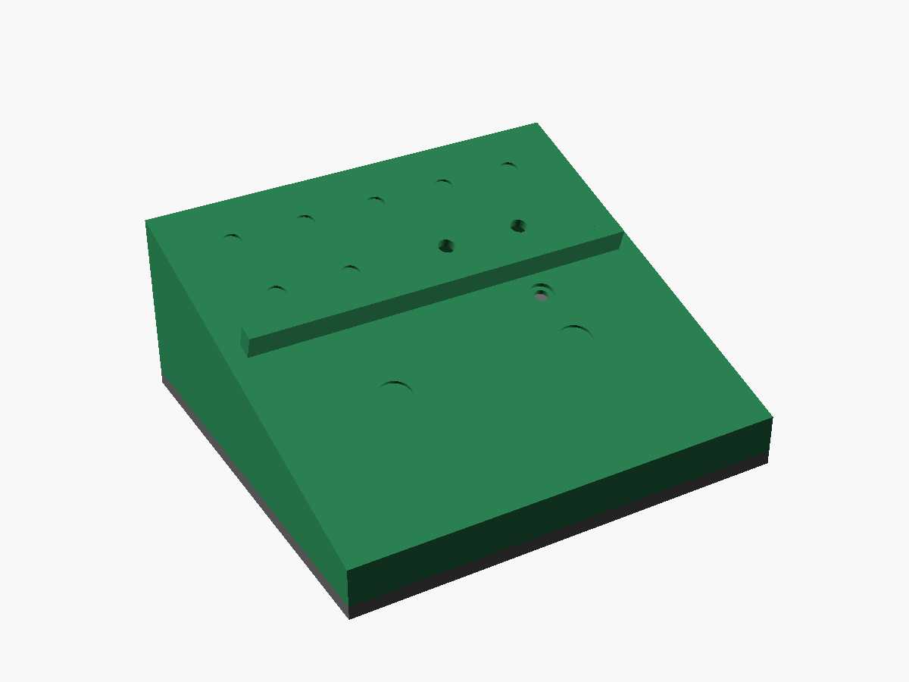
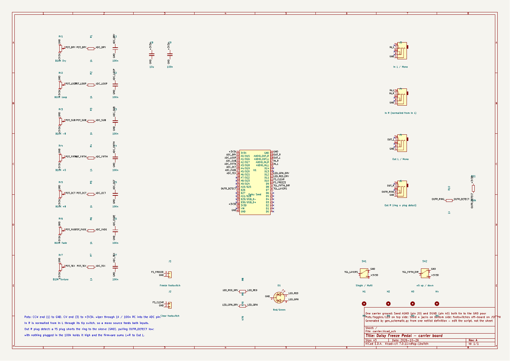
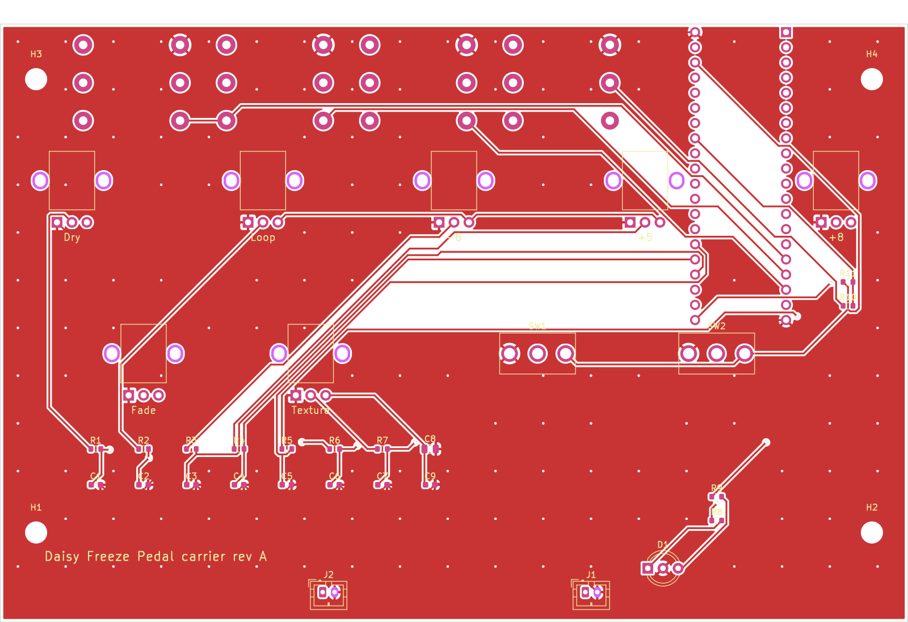
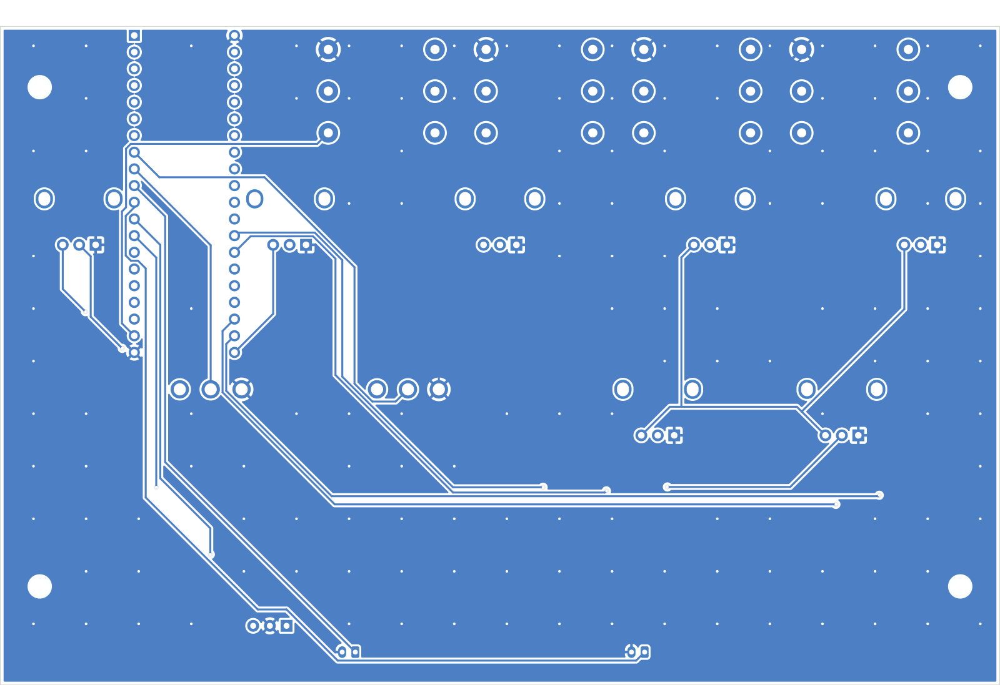
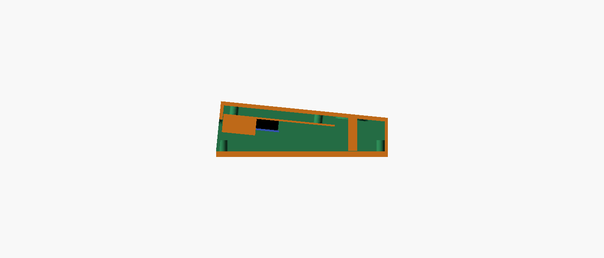

# Daisy Freeze Pedal

A line-level stereo freeze/drone floor pedal built on the Electrosmith Daisy Seed, designed for playing hands-free alongside a WARBL wind controller or analog synths. Hold a footswitch to record, release to loop; the loop plays back as a Clouds-style granular freeze with sub-octave, fifth and octave voices.



## Status

Prototyping. The DSP and control scheme are validated in a browser bench model; the enclosure has a first-pass parametric model. Next: validate the panel on the bench, then draw the carrier schematic.

## Panel

| Control | Type | Function |
|---|---|---|
| Freeze | Soft-touch momentary footswitch | Hold to record (up to 8 s), release to start looping |
| Clear | Soft-touch momentary footswitch | Tap: fade out the oldest layer. Hold 0.7 s: clear all |
| Dry | Pot | Passthrough level |
| Loop | Pot | Frozen 1:1 voice level |
| −8 | Pot | Sub-octave voice (1:2), 28 Hz high-pass |
| +5 | Pot | Fifth voice, 3:2 up or 3:4 down |
| +8 | Pot | Octave voice (2:1) |
| Fade | Pot | Layer swell-in and release time, 20 ms to 8 s |
| Texture | Pot | Macro: grain size, window shape and density, smooth → grainy |
| Single / Multi | Toggle | Single crossfades each capture over the last loop; Multi stacks up to 6 layers |
| +5 up / down | Toggle | Fifth above (3:2) or below (3:4) |
| LED | Bi-color | Red while recording, green while layers play, off when empty |

Fixed in firmware: grain spread, drift (random per-grain detune), output level. No reverb.

## I/O and power

- Four switched 1/4" jacks on the back face: In L/Mono, In R, Out L/Mono, Out R.
  - Nothing in In R: In L is normalled to both channels.
  - Nothing in Out R: L+R is summed to Out L (detected on a GPIO via the jack switch).
- Line level in and out; no instrument buffer needed. Optional input pad/trim for hot +4 dBu sources.
- The Daisy Seed's own micro-USB faces the back wall for 5 V power and firmware updates. Holding Clear at power-up will jump to the bootloader so the case never needs opening to flash.

## Hardware plan

- **One carrier PCB** mounted parallel to the panel carries everything except the footswitches:
  - Top side: seven 9 mm PCB-mount pots (plastic shafts), two PCB-mount mini toggles, LED under a light pipe.
  - Underside, rear edge: four right-angle 1/4" jacks with threaded bushings (nutted to the back wall so plug forces go into the case) and the Daisy Seed on female headers, its micro-USB facing the back wall.
- **Footswitches** are nutted to the panel and wired to 2-pin locking connectors on the carrier; stomps never load solder joints.
- **Enclosure**: reinforced 3D-printed wedge, PETG or ASA. See [`enclosure/`](enclosure/).

## Parts chosen so far

| Part | Choice | Notes |
|---|---|---|
| Pots (×7) | [Alpha RV09AF-40-20K-B10K](https://www.jameco.com/z/RV09AF-40-20K-B10K-Taiwan-Alpha-9mm-Linear-Taper-Potentiometer-10K-Ohm-50mW-20-20mm-Long-Vertical-Knurled-Shaft_2272207.html) (Jameco 2272207): 9 mm, vertical PCB mount, 20 mm knurled plastic shaft, B10K linear | 7.0 mm mounting height. Used bare, no knobs or caps: the knurled shaft is the grip, with a painted index line across its top face. |
| Toggles (×2) | E-Switch 100SP1T1B1M2QE: SPDT on-on, PCB mount (M2), threaded 1/4"-40 bushing (B1, 8.89 mm) | Body is 6.6 mm from PCB to bushing base and seats on a 0.9 mm pad under the panel; 4.5 mm of thread above the panel takes the nut. Note: the B4 variant has an unthreaded bushing and can't be nutted to the panel. |
| Footswitches (×2) | Soft-touch momentary SPST, M12 bushing | Panel-mounted, wired to the carrier. |
| Jacks (×4) | Neutrik NMJ6HCD2: 1/4" stereo, switched, horizontal PCB, chrome ferrule with nut | Axis 9.1 mm from the PCB, 18.2 mm wide, 11.4 mm panel cut-out. Mounted on the carrier underside. |
| Seed sockets | 2× 1×20 female headers, 2.54 mm, 8.5 mm tall | Daisy Seed hangs below the carrier, micro-USB to the back wall. |
| LED | 5 mm bi-colour red/green, common cathode, 3-lead | Driven from two GPIOs through 470 Ω. |
| Footswitch connectors (×2) | JST PH 2-pin vertical (B2B-PH-K) | Footswitches are wired to mating plugs. |

Board stack (from the datasheets): the RV09 pot's shaft length L is measured from the PCB seating plane and its body is 7.0 mm tall, so the carrier sits 7.5 mm under the panel; with the 3.5 mm panel, a 20 mm shaft stands 9 mm above the panel.

## Carrier board

KiCad 7 project in [`pcb/carrier/`](pcb/carrier/): schematic, routed two-layer board, and fab outputs. Everything is generated by scripts so the schematic, board and case stay in step.



| Board side | Parts |
|---|---|
| Top (faces the panel) | 7 pots, 2 toggles, LED, 2 footswitch connectors, all SMD parts (fab-placed) |
| Bottom | Daisy Seed on sockets, 4 jacks along the rear edge |

**Seed pin map**

| Function | Seed pin | Notes |
|---|---|---|
| Dry, Loop, −8, +5, +8, Fade, Texture pots | A0–A6 (pins 22–28) | Pot ends on 3V3A / GND; wiper through 1 k / 100 nF RC |
| Audio in L / R | 16 / 17 | Codec inputs are AC-coupled internally, 3.6 Vpp max; In R is normalled from In L by its tip switch |
| Audio out L / R | 18 / 19 | 100 Ω output impedance |
| Single / Multi toggle | D7 (pin 8) | Toggle switches the pin between 3V3D and DGND |
| +5 up / down toggle | D8 (pin 9) | Same |
| Freeze / Clear footswitches | D9 / D10 (pins 10 / 11) | To DGND; use internal pull-ups |
| LED red / green | D11 / D12 (pins 12 / 13) | 470 Ω each |
| Out R plug detect | D26 (pin 33) | A TS plug shorts Out R's ring to sleeve, pulling the pin low; 100 k pull-up, 1 k series |
| Power | 3V3A (21), 3V3D (38), AGND (20), DGND (40) | AGND and DGND both tie to one carrier ground (the datasheet requires them joined) |

The Seed is powered from its own micro-USB. VIN is left unconnected.

| Top side | Bottom side (seen from below) |
|---|---|
|  |  |

**Regenerate**

```
cd pcb/carrier
python3 gen_schematic.py   # writes carrier.kicad_sch and the project libraries
python3 gen_pcb.py         # reads the netlist and the case geometry, places parts in carrier.kicad_pcb
python3 route_pcb.py freerouting.jar   # design rules, Freerouting autoroute, GND pour both layers + stitching vias, DRC report
python3 make_fab.py        # Gerbers + drill (fab/carrier-gerbers.zip), bom-jlc.csv, cpl-jlc.csv
```

Routing: 0.3 mm tracks, 0.25 mm clearance, 0.8/0.4 mm vias, ground poured on both layers and stitched together with a via grid. The DRC report (`drc-report.txt`) shows 0 violations and 0 unconnected pads. `route_pcb.py` uses [Freerouting](https://github.com/freerouting/freerouting) 1.9 (Java) and retries until every connection is made.

**Ordering**
- Upload `fab/carrier-gerbers.zip` for a 2-layer, 1.6 mm board (152 × 100 mm).
- For fab assembly of the 20 SMD parts (top side only), upload `fab/bom-jlc.csv` and `fab/cpl-jlc.csv`. They are all non-polarised 0603/0805 resistors and capacitors, so a 180° rotation can't put one in backwards; just confirm none show up 90° off in the placement preview.
- SMD parts (all JLC basic parts, checked on jlcpcb.com): 1 k UNI-ROYAL 0603WAF1001T5E (C21190), 100 k 0603WAF1003T5E (C25803), 470 Ω 0603WAF4700T5E (C23179), 100 nF YAGEO CC0603KRX7R9BB104 (C14663), 10 µF 25 V Samsung CL21A106KAYNNNE (C15850).
- All through-hole parts are hand-soldered; see Board assembly below.

`gen_pcb.py` reads every panel and back-wall position from the OpenSCAD model through `enclosure_params.scad`, so moving a control in the case moves its part on the board. Fitting the Seed's pin rows between the +5 and +8 pots set the top-row spacing to 32 mm; the narrowest gap on the board is 1.2 mm between a pot tab hole and a Seed pin.

**Checked**
- Jack fit: Neutrik rates the NMJ6HCD2 for panels under 4.7 mm, so the 3 mm printed back wall is fine.
- Part numbers: all five LCSC numbers match their values and packages.
- Before printing the full case, a quick test print of the back wall with one jack and nut is still a good idea.

## Board assembly

- **Through-hole by hand:** pots, toggles, jacks, Seed headers and LED. Fab through-hole assembly is mostly manual and costs extra, so it isn't worth it for these.
- **Small parts:** the 20 resistors and capacitors in the pot filters, LED drive and plug detect. Either use 0805 SMD (or through-hole) and solder them by hand, or have the fab place only these SMD parts from its basic-parts library.
- **Alignment jig (solder last):** fit the pots, toggles and jacks into the board unsoldered, seat the board on its standoffs in the printed shell, and run the toggle and jack nuts on so every part lines up with its hole. Then solder from the underside. Everything ends up square to the panel and back wall.
- **Footswitches** are nutted to the panel and plug into 2-pin locking connectors on the carrier after the board is in.

## Repository layout

```
bench/index.html                 Browser prototype of the pedal (AudioWorklet DSP + simulated synth input)
enclosure/freeze_pedal_case.scad Parametric OpenSCAD enclosure
enclosure/stl/                   shell.stl, plate.stl (first pass, renders manifold)
enclosure/renders/               Front, side and underside views
pcb/carrier/                     KiCad 7 carrier board: schematic, placed board, generator scripts
```

## Bench prototype

Open `bench/index.html` in a browser (Chrome, Safari or Firefox). Power on, start the melody or play the keyboard, then hold Freeze. The DSP engine is written as a plain class so it ports to DaisySP C++ almost line for line:

- 8 s stereo ring buffer, record buffer preallocated (no allocation on the audio thread at capture)
- Grains read with Hermite interpolation; voices above 1:1 read a copy low-passed at 0.2·fs to avoid aliasing
- Up to 6 layers, each with its own fade envelope; 4 voices per layer
- tanh soft clip at the output

## Enclosure

- Wedge, front to back only: 35 mm overall at the front rising to 50 mm at the back (≈5.7° panel), 150 mm deep, 160 mm wide. ≈28 mm of clearance under the panel at the footswitches (the model echoes this value); jacks sit low on the back wall so their bodies pass under the carrier PCB.
- Flat 5 mm removable bottom plate for a full rubber mat; six M3 SHCS counterbored from below into Ruthex heat-set inserts.
- Each footswitch: thickened panel pad plus two 8 × 8 mm columns straight down to the bottom plate, so stomps load the floor rather than the panel.
- Panel face is completely flat (no ridges or recesses) so the shell prints face-down without supports; the back wall, square to the panel, prints vertical. The carrier sits 7.5 mm under the panel and the panel holes bear the pot shafts.


- Back wall is perpendicular to the panel so the board-mounted jacks meet it square. Jack and USB openings are slots open at the bottom: the carrier slides up into the shell, then the jack nuts clamp it to the wall.
- `part = "carrier"` renders the board, jacks and Seed as reference geometry for fit checks.
- Print the shell face down (panel face on the bed). 4+ perimeters, 40%+ gyroid, 100% infill around the footswitch pads.

Dimensions marked `VERIFY` in the SCAD file depend on the parts you buy: pot body height, footswitch thread length, jack bushing size, USB-C panel module cutout.

## License

MIT. See [LICENSE](LICENSE). Covers the firmware model, bench, enclosure design files and documentation in this repository.
