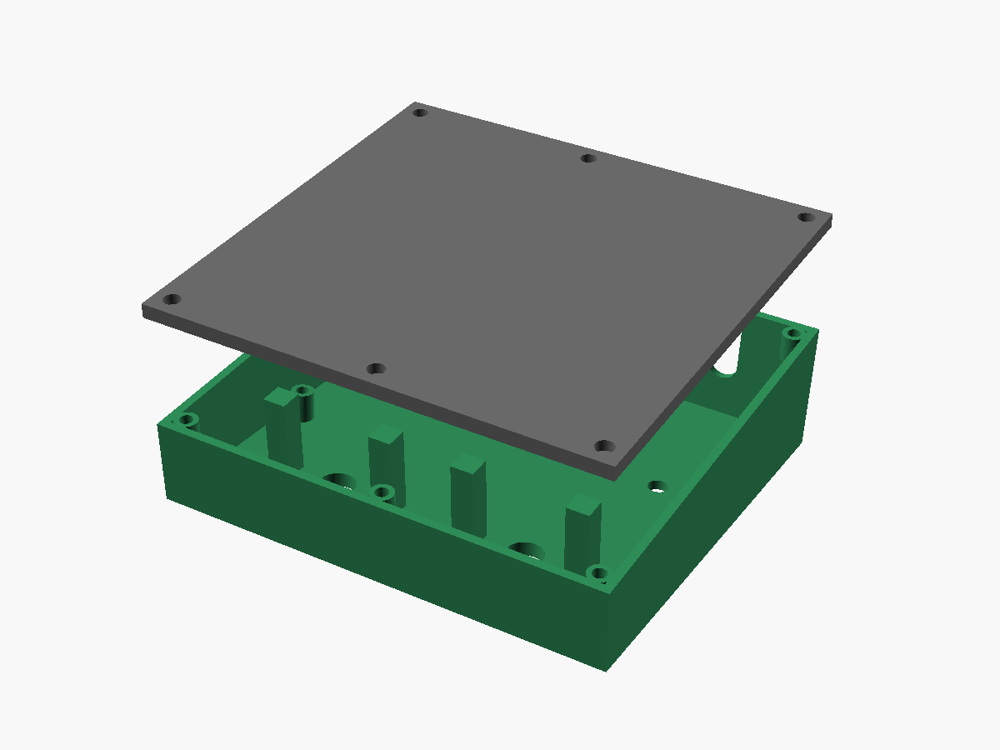

# Daisy Freeze Pedal

A line-level freeze/drone floor pedal (mono in, stereo out) built on the Electrosmith Daisy Seed3, designed for playing hands-free alongside a WARBL wind controller or analog synths. Hold a footswitch to record, release to loop; the loop plays back as a Clouds-style granular freeze with sub-octave, fifth and octave voices.


## Status

Ready to order. The DSP and controls are proven in a browser bench model. The carrier is a bare, all-through-hole board you solder yourself, routed and DRC-clean; the case is a parametric OpenSCAD model. Next: order bare boards and parts, print the case, then port the bench engine to DaisySP.

## Panel

| Control | Type | Function |
|---|---|---|
| Freeze | Soft-touch momentary footswitch | Hold to record (up to 8 s), release to start looping |
| Clear | Soft-touch momentary footswitch | Tap: fade out the oldest layer. Hold 0.7 s: clear all |
| Dry | Pot | Passthrough level |
| Loop | Pot | Frozen 1:1 voice level |
| −8 | Pot | Sub-octave voice (1:2), 28 Hz high-pass |
| +5 | Pot | Fifth voice, 3:2 up or 3:4 down |
| +8 | Pot | Octave voice (2:1) |
| Fade | Pot | Layer swell-in and release time, 20 ms to 8 s |
| Texture | Pot | Macro: grain size, window shape and density, smooth → grainy |
| Single / Multi | Toggle | Single crossfades each capture over the last loop; Multi stacks up to 6 layers |
| +5 up / down | Toggle | Fifth above (3:2) or below (3:4) |
| LED | Bi-color | Red while recording, green while layers play, off when empty |

Fixed in firmware: grain spread, drift (random per-grain detune), output level. No reverb.

## I/O and power

- Three switched 1/4" jacks on the back face: In (mono), Out L/Mono, Out R.
  - The mono input feeds both codec inputs; the voices are spread across the stereo outputs.
  - Nothing in Out R: the firmware sums L+R to Out L (detected through Out R's ring switch).
- Line level in and out, no buffer and no input pad. The Seed3 clips at 3.6 Vpp (+4.3 dBu) and is rated to ±1.8 V, so keep very hot synth outputs turned down.
- The Seed3's own USB-C faces the back wall for 5 V power and firmware updates. Holding Clear at power-up will jump to the bootloader so the case never needs opening to flash.

## Hardware plan

- **One carrier PCB** mounted parallel to the panel carries everything except the footswitches:
  - Top side: seven 9 mm PCB-mount pots (plastic shafts), two PCB-mount mini toggles, LED on a spacer, and six resistors/capacitors.
  - Underside, rear edge: three right-angle 1/4" jacks with threaded bushings (nutted to the back wall so plug forces go into the case) and the Seed3 on female headers, its USB-C facing the back wall.
- **Footswitches** are nutted to the panel and wired to 2-pin locking connectors on the carrier; stomps never load solder joints.
- **Enclosure**: reinforced 3D-printed wedge, PETG or ASA. See [`enclosure/`](enclosure/).

## Parts

| Part | Choice | Notes |
|---|---|---|
| Pots (×7) | Alpha RV09AF-40-20K-B10K: 9 mm, vertical PCB mount, 20 mm knurled plastic shaft, B10K linear ([Jameco 2272207](https://www.jameco.com/z/RV09AF-40-20K-B10K-Taiwan-Alpha-9mm-Linear-Taper-Potentiometer-10K-Ohm-50mW-20-20mm-Long-Vertical-Knurled-Shaft_2272207.html), also Mouser and Tayda; the 25 mm length isn't stocked) | 7.6 mm tall body. Used bare, no knobs or caps: the knurled shaft is the grip, with a painted index line across its top face. |
| Toggles (×2) | E-Switch 100SP1T1B1M2RE (gold contacts; any 100SP1…M2 variant fits the board): SPDT on-on, PCB mount (M2), threaded 1/4"-40 bushing (B1, 8.89 mm) | Catalog p.2: single-pole body 8.89 mm; M2 drawing p.8: pins stand the body 1.5 mm off the board. Bushing base sits 10.39 mm above the PCB and seats on the panel underside; 6.4 mm of thread above the 2.5 mm panel takes the nut. The B4 variant's bushing is unthreaded. |
| Footswitches (×2) | Soft-touch momentary SPST, M12 bushing | Panel-mounted, wired to the carrier. |
| Jacks (×3) | Neutrik NMJ6HCD2: 1/4" stereo, switched, horizontal PCB, chrome ferrule with nut | Axis 7.53 mm from the PCB (drawing: 15.67 body, axis 8.14 below its top), 18.2 mm wide, 11.4 mm panel cut-out, panels under 4.7 mm. Mounted on the carrier underside. |
| Seed sockets | 2× 1×20 female headers, 2.54 mm, 8.5 mm tall | Seed3 hangs below the carrier on its 2.5 mm header spacer, USB-C to the back wall. |
| LED | 5 mm bi-colour red/green, common cathode, 3-lead, on a 4 mm LED spacer | Spacer puts the dome 0.3 mm below the panel top. Driven from two GPIOs through 470 Ω; pick R per die once the LED is chosen (a true-green die needs less). |
| Footswitch pads (×2) | J1/J2, 2 mm JST PH footprint, left unpopulated | Solder 24–26 AWG leads straight into the pads (polarity doesn't matter). A B2B-PH-K header and plug can be fitted later if you want the footswitches unpluggable. |
| Output coupling (×2 each) | 10 µF 25 V X7R radial MLCC (5 mm leads), 100 k ¼ W | One capacitor in series and one resistor to ground per output. |
| LED resistors (×2) | 470 Ω ¼ W | |

The full list is in [`pcb/carrier/fab/bom.csv`](pcb/carrier/fab/bom.csv): 26 parts, all through-hole. Add two 1×20 female headers for the Seed3; the footswitches are wired straight to J1/J2.

Board stack (from the datasheets): the toggle's bushing base sits 10.39 mm above the board, so the carrier hangs 10.39 mm under the 2.5 mm panel. Pot bodies (7.6 mm) sit below the panel and the panel holes bear their shafts. RV09 shaft length L is measured from the PCB, so a 20 mm shaft stands 7.1 mm above the panel. The panel is 2.5 mm (not thicker) to keep that grip; the board height is fixed by the toggles, so only a thinner panel adds shaft.

## Carrier board

KiCad 7 project in [`pcb/carrier/`](pcb/carrier/): schematic, routed two-layer board, Gerbers and a hand-solder parts list. Everything is generated by scripts so the schematic, board and case stay in step. Rev B is all through-hole with only six small parts: two output capacitors, two output bleed resistors and two LED resistors. The pots go straight to the ADC pins (the firmware smooths them), the Seed3's own supply filtering is enough, and the toggles, footswitches and Out R detect use the Seed's internal pull-ups.


| Board side | Parts |
|---|---|
| Top (faces the panel) | 7 pots, 2 toggles, LED, 2 footswitch connectors, 6 resistors/capacitors |
| Bottom | Seed3 on sockets, 3 jacks along the rear edge |

**Seed pin map**

| Function | Seed pin | Notes |
|---|---|---|
| Dry, Loop, −8, +5, +8, Fade, Texture pots | A0–A6 (pins 22–28) | Pot ends on 3V3A / GND; wiper straight to the pin |
| Audio in | 16 and 17 | Mono input wired to both codec inputs. The In jack's tip switch grounds the input when empty. Seed3 limit 3.6 Vpp (+4.3 dBu), absolute max ±1.8 V. |
| Audio out L / R | 18 / 19 | 10 µF in series and 100 k to ground at each jack, as in the Seed3 reference circuit |
| Single / Multi toggle | D7 (pin 8) | Toggle switches the pin between 3V3D and GND |
| +5 up / down toggle | D8 (pin 9) | Same |
| Freeze / Clear footswitches | D9 / D10 (pins 10 / 11) | To GND; use internal pull-ups |
| LED red / green | D11 / D12 (pins 12 / 13) | 470 Ω each |
| Out R plug detect | D26 (pin 33) | Out R's ring is grounded and its ring-normal contact goes to the pin: empty jack reads low, any plug (TS or TRS) reads high. Use the internal pull-up. |
| Power | 3V3A (21), 3V3D (38), AGND (20), DGND (40) | AGND and DGND both tie to one carrier ground (the datasheet requires them joined) |

The Seed3 is powered from its own USB-C. VIN is left unconnected. Use an isolated or battery USB supply if the mains-grounded synth and amp cause hum.

| Top side | Bottom side (seen from below) |
|---|---|
|  |  |

**Regenerate**

```
cd pcb/carrier
python3 gen_schematic.py   # writes carrier.kicad_sch and the project libraries
python3 gen_pcb.py         # reads the netlist and the case geometry, places parts in carrier.kicad_pcb
python3 route_pcb.py freerouting.jar   # design rules, Freerouting autoroute, GND pour both layers + stitching vias, DRC report
python3 make_fab.py        # Gerbers + drill (fab/carrier-gerbers.zip) and the hand-solder bom.csv
```

Routing: 0.3 mm tracks, 0.25 mm clearance, 0.8/0.4 mm vias, ground poured on both layers and stitched together with a via grid. The DRC report (`drc-report.txt`) shows 0 violations and 0 unconnected pads. `route_pcb.py` uses [Freerouting](https://github.com/freerouting/freerouting) 1.9 (Java) and retries until every connection is made.

**Ordering**
- Upload `fab/carrier-gerbers.zip` for a bare 2-layer, 1.6 mm board (152 × 100 mm). No assembly; the cheapest economy shipping is fine.
- Every part is through-hole and hand-soldered; see Board assembly below.

`gen_pcb.py` reads every panel and back-wall position from the OpenSCAD model through `enclosure_params.scad`, so moving a control in the case moves its part on the board. Fitting the Seed's pin rows between the +5 and +8 pots set the top-row spacing to 32 mm; the narrowest gap on the board is 1.2 mm between a pot tab hole and a Seed pin.

**Checked**
- Jack fit: Neutrik rates the NMJ6HCD2 for panels under 4.7 mm, so the 3 mm printed back wall is fine.
- Seed3 (datasheet v2.1) pinout is identical to the original Seed; USB-C overhangs the board end by 1.55 mm, so the back-wall slot is 14 × 9 mm.
- An independent review checked footprints, pin map, wiring and fab files against the datasheets; its fixes are applied.
- Printed holes often come out slightly undersize: if a jack or toggle won't go in, open the hole with an 11.5 mm drill or step bit (jacks) or a 1/4" bit (toggles).
- With a meter, confirm the NMJ6HCD2 ring-normal (RN) contact opens on plug insertion before relying on Out R detection; the drawing has no contact diagram.

## Board assembly

- **Everything by hand:** the board is ordered bare and every part is through-hole.
- **Small parts first:** the six resistors and capacitors lie flat, so solder them before anything tall.
- **Alignment jig (solder last):** fit the pots, toggles and jacks into the board unsoldered, seat the board on its standoffs in the printed shell, and run the toggle and jack nuts on so every part lines up with its hole. Then solder from the underside. Everything ends up square to the panel and back wall.
- **Footswitches** are nutted to the panel and plug into 2-pin locking connectors on the carrier after the board is in.

## Repository layout

```
bench/index.html                 Browser prototype of the pedal (AudioWorklet DSP + simulated synth input)
enclosure/freeze_pedal_case.scad Parametric OpenSCAD enclosure
enclosure/stl/                   shell.stl, plate.stl (first pass, renders manifold)
enclosure/renders/               Front, side and underside views
pcb/carrier/                     KiCad 7 carrier board: schematic, placed board, generator scripts
```

## Bench prototype

Open `bench/index.html` in a browser (Chrome, Safari or Firefox). Power on, start the melody or play the keyboard, then hold Freeze. The DSP engine is written as a plain class so it ports to DaisySP C++ almost line for line:

- 8 s stereo ring buffer, record buffer preallocated (no allocation on the audio thread at capture)
- Grains read with Hermite interpolation; voices above 1:1 read a copy low-passed at 0.2·fs to avoid aliasing
- Up to 6 layers, each with its own fade envelope; 4 voices per layer
- tanh soft clip at the output

## Enclosure

- Wedge, front to back only: 35 mm overall at the front rising to 50 mm at the back (≈5.7° panel), 150 mm deep, 160 mm wide. ≈29 mm of clearance under the panel at the footswitches (the model echoes this value); jacks sit low on the back wall so their bodies pass under the carrier PCB.
- Flat 5 mm removable bottom plate for a full rubber mat. It's held by six M3×8 socket-head screws (four corners, front and back centre) that go up through counterbored holes in the plate into M3 heat-set inserts (Ruthex 4.6 mm) pressed into bosses along the bottom edge of the shell walls. Install the inserts from below with the shell upside down.


- Each footswitch: thickened panel pad plus two 8 × 8 mm columns straight down to the bottom plate, so stomps load the floor rather than the panel.
- Panel face is completely flat (no ridges or recesses) so the shell prints face-down without supports; the back wall, square to the panel, prints vertical. The carrier sits 10.39 mm under the panel (set by the toggles) and the panel holes bear the pot shafts.


- Back wall is perpendicular to the panel so the board-mounted jacks meet it square. Jack and USB openings are slots open at the bottom: the carrier slides up into the shell, then the jack nuts clamp it to the wall.
- `part = "carrier"` renders the board, jacks and Seed as reference geometry for fit checks.
- Print the shell face down (panel face on the bed). 4+ perimeters, 40%+ gyroid, 100% infill around the footswitch pads.

Part dimensions in the SCAD file come from the datasheets (Alpha RV09, E-Switch 100 series, Neutrik NMJ6HCD2, Seed3 v2.1). The footswitch body depth is the one value still to confirm against the switch you buy; there is about 29 mm of clearance.

## License

MIT. See [LICENSE](LICENSE). Covers the firmware model, bench, enclosure design files and documentation in this repository.
